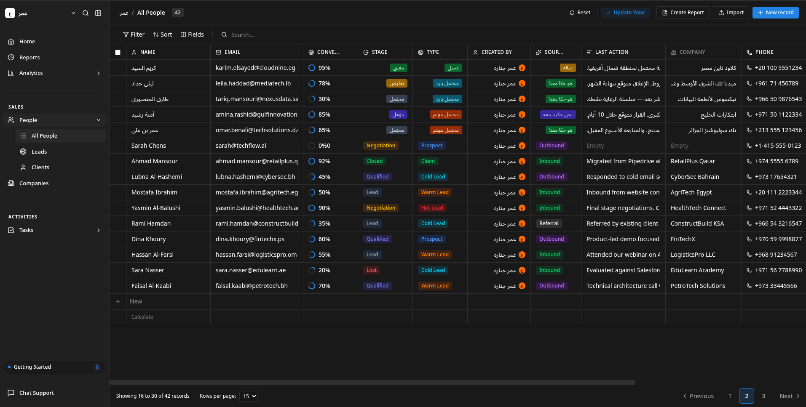
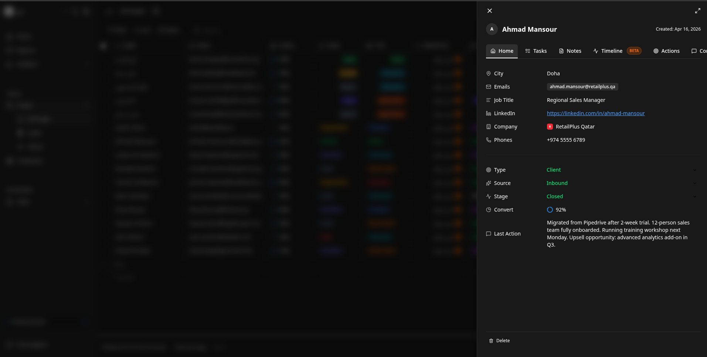
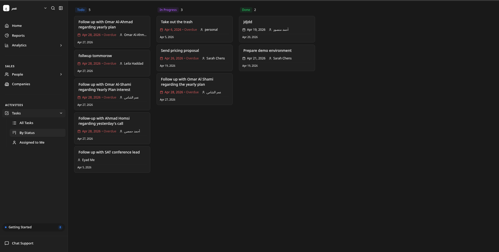
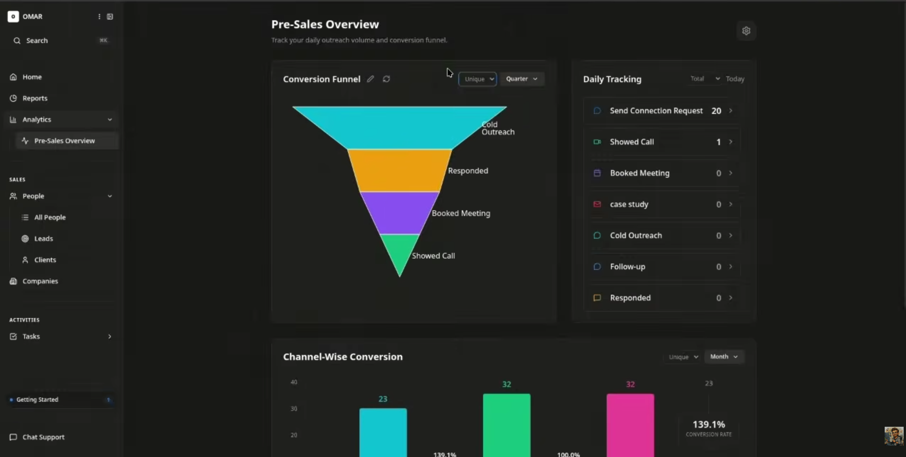
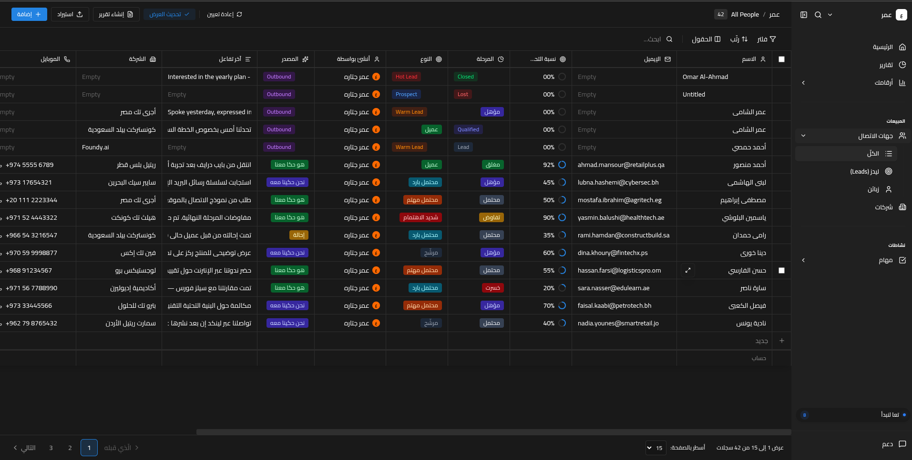

<div align="center">

# FounderStack CRM

**A context-first CRM for solo founders — built with a Notion-style dark mode interface, AI-assisted relationship management, and full Arabic RTL support.**

[](http://crm-landing-three.vercel.app/)
[](https://www.youtube.com/watch?v=RszxHrbMZFg)


</div>

---

## Live Demo

**[crm-landing-three.vercel.app](http://crm-landing-three.vercel.app/)**

Watch the full walkthrough on YouTube:

[](https://www.youtube.com/watch?v=RszxHrbMZFg)

---

## Screenshots

### Contacts & People Management


### Contact Details & Context Drawer


### Task Management (Kanban)


### Analytics & Pre-Sales Overview


### Arabic RTL Support


---

## Architecture

```
┌─────────────────────────────────────────────────────────┐
│                    Frontend (React 19)                   │
│  Tailwind CSS · Zustand · React Router · @dnd-kit       │
└──────────────────────┬──────────────────────────────────┘
                       │ REST API (JWT)
┌──────────────────────▼──────────────────────────────────┐
│                   Backend (Django 6.0)                   │
│  DRF · RBAC · API Keys · Inngest · Webhooks             │
├──────────────┬───────────────┬──────────────────────────┤
│  PostgreSQL  │     Redis     │    AI Agent (MCP)        │
└──────────────┴───────────────┴──────────────────────────┘
```

---

## Project Structure

```
opensourced/
├── backend/          # Django REST Framework API
├── frontend/         # React SPA with Notion-style UI
├── mcp-server/       # MCP server for AI assistant integration
├── imgs/             # Screenshots and assets
├── backend_instructions.md
└── frontend_instructions.md
```

---

## Backend

Django REST Framework backend with multi-tenant architecture, RBAC, triple auth (JWT + API Keys + Session), background job scheduling, and external system sync.

**Full documentation:** [backend/README.md](https://github.com/Othunderlight/FounderStackCRM-open/blob/main/backend/README.md)

| Layer | Technology |
|-------|-----------|
| Framework | Django 6.0, DRF 3.16 |
| Auth | JWT (RS256), API Keys, Session, Google OAuth2 |
| Database | PostgreSQL 15 |
| Cache | Redis 7 |
| Background Jobs | Inngest |
| Containerization | Docker, Docker Compose |

### Key Features
- Multi-tenant data isolation per organization
- 4 default RBAC roles with 30 granular permission scopes
- Fuzzy search with custom relevance scoring
- Bulk import on all major endpoints
- Automated GitHub backups via Inngest cron
- HMAC-SHA256 signed webhooks with delivery logging
- OpenAPI docs at `/api/schema/swagger-ui/`

---

## Frontend

React 19 SPA with a Notion-style dark mode interface, data grids, kanban boards, context drawers, and full Arabic RTL support.

**Full documentation:** [frontend/README.md](https://github.com/Othunderlight/FounderStackCRM-open/blob/main/frontend/README.md)

| Layer | Technology |
|-------|-----------|
| Framework | React 19 + TypeScript |
| Styling | Tailwind CSS v4 |
| State | Zustand 5 (persist) |
| Routing | React Router DOM 7 |
| Drag & Drop | @dnd-kit |
| Charts | Recharts 3 |
| UI | Radix UI + shadcn/ui |

### Key Features
- Sortable, filterable data grids for People, Companies, Tasks, Notes
- Drag-and-drop kanban boards for Opportunities and Tasks
- Context drawer for quick record preview and editing
- Cmd+K global search across all entities
- Custom views with saved filter/sort/column configs
- CSV import for any entity type
- Mobile responsive with dedicated bottom navigation
- Keyboard shortcuts (Shift+P, Shift+T, Shift+C, Shift+L)

---

## MCP Server

FastAPI-based Model Context Protocol server that gives AI assistants (Claude, Cursor, Gemini CLI) secure, authenticated access to CRM data via JWT or API key.

**Full documentation:** [mcp-server/README.md](https://github.com/Othunderlight/FounderStackCRM-open/blob/main/mcp-server/README.md)

| Layer | Technology |
|-------|-----------|
| Framework | FastAPI + FastMCP 3.0 |
| Auth | JWT (RS256) + API Keys + OAuth2 |
| Protocol | MCP (Model Context Protocol) |

### Key Features
- 25+ MCP tools for CRM operations (people, companies, tasks, notes, activities)
- Dual auth: JWT Bearer tokens and API keys
- OAuth2 dynamic client registration for AI desktop apps
- Auto-discovery via `.well-known` endpoints
- Proxies all requests to Django backend with proper auth

---

## AI Agent

FounderStack CRM ships with a multi-agent AI system for natural language CRM operations — create people, query tasks, update records, and more via conversational input.

**Agent repository:** [github.com/Othunderlight/tammam-agent](https://github.com/Othunderlight/tammam-agent)

| Agent | Role |
|-------|------|
| Decider | Routes to Task Agent or Main Agent |
| Main | Plans CRM actions (CRUD on entities) |
| Task | Specialized task management |
| Voice | Combined planner for voice input |
| Middle | Resolves entity IDs from fuzzy queries |
| Final | Formats user-facing responses |

---

## Getting Started

### Prerequisites

- Python 3.12+
- Node.js 18+
- PostgreSQL 15+
- Redis 7+
- Docker & Docker Compose (optional)

### Backend

```bash
cd backend
python -m venv .venv
source .venv/bin/activate
pip install -r reqs.txt
cp .env.example .env
# Generate JWT keys
python -c "
from cryptography.hazmat.primitives import serialization
from cryptography.hazmat.primitives.asymmetric import rsa
private_key = rsa.generate_private_key(public_exponent=65537, key_size=2048)
public_key = private_key.public_key()
with open('jwt_private_key.pem', 'wb') as f:
    f.write(private_key.private_bytes(serialization.Encoding.PEM, serialization.PrivateFormat.PKCS8, serialization.NoEncryption()))
with open('jwt_public_key.pem', 'wb') as f:
    f.write(public_key.public_bytes(serialization.Encoding.PEM, serialization.PublicFormat.SubjectPublicKeyInfo))
"
python manage.py migrate sites
python manage.py makemigrations users
python manage.py migrate
python manage.py createsuperuser
python manage.py runserver
```

Or with Docker:

```bash
cd backend
docker-compose up --build -d
```

### Frontend

```bash
cd frontend
npm install
cp .env.example .env.local
# Edit .env.local with your Supabase credentials and API URLs
npm run dev
```

The app runs at `http://localhost:3000`.

### MCP Server

```bash
cd mcp-server
pip install -e .
cp .env.example .env
# Edit .env with your Django backend URL
mcp-server
```

The MCP server runs at `http://localhost:10000`.

---

## Environment Variables

Both `backend/.env.example` and `frontend/.env.example` contain all required variables with placeholder values. Copy them to get started:

```bash
cp backend/.env.example backend/.env
cp frontend/.env.example frontend/.env.local
cp mcp-server/.env.example mcp-server/.env
```

Then edit each file with your own credentials. See the individual READMEs for full variable documentation:

- [Backend env vars](https://github.com/Othunderlight/FounderStackCRM-open/blob/main/backend/README.md#environment-variables)
- [Frontend env vars](https://github.com/Othunderlight/FounderStackCRM-open/blob/main/frontend/README.md#environment-variables)
- [MCP Server env vars](https://github.com/Othunderlight/FounderStackCRM-open/blob/main/mcp-server/README.md#configuration-reference)

---

## Keyboard Shortcuts

| Shortcut | Action |
|----------|--------|
| `Ctrl/Cmd + B` | Toggle sidebar |
| `Shift + P` | Go to All People |
| `Shift + T` | Go to All Tasks |
| `Shift + C` | Go to Companies |
| `Shift + L` | Go to Activity Logs |
| `Ctrl/Cmd + K` | Global search |

---

## Contributing

1. Fork the repo
2. Create a feature branch
3. Make your changes
4. Run linting (`ruff check .` for backend)
5. Submit a pull request

---

## License

MIT
