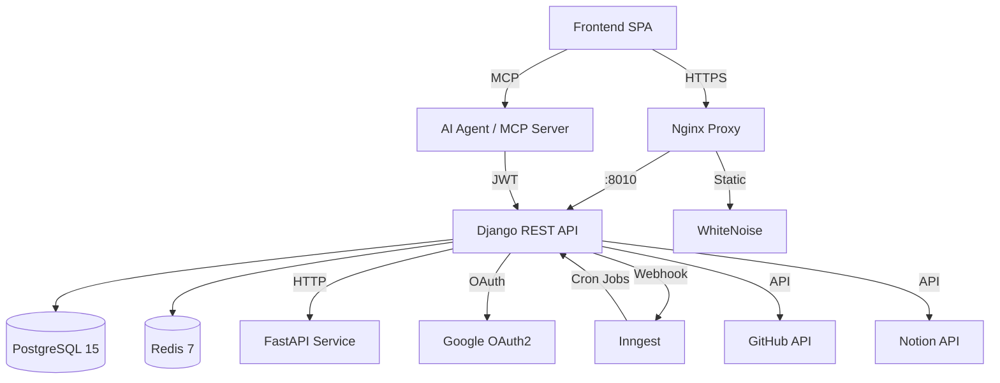
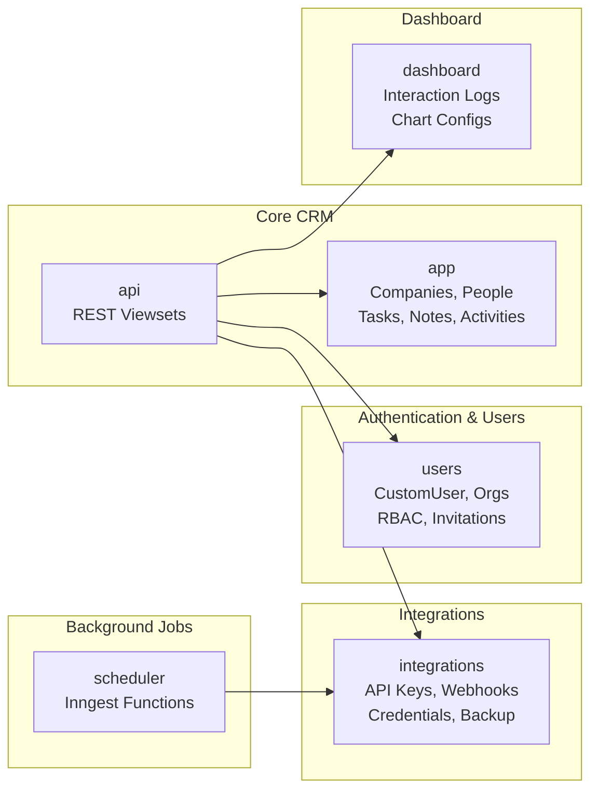
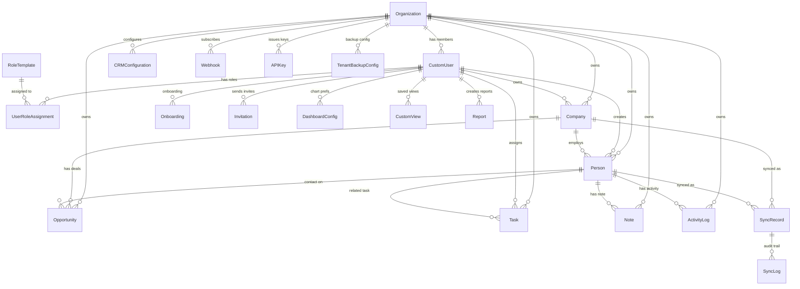
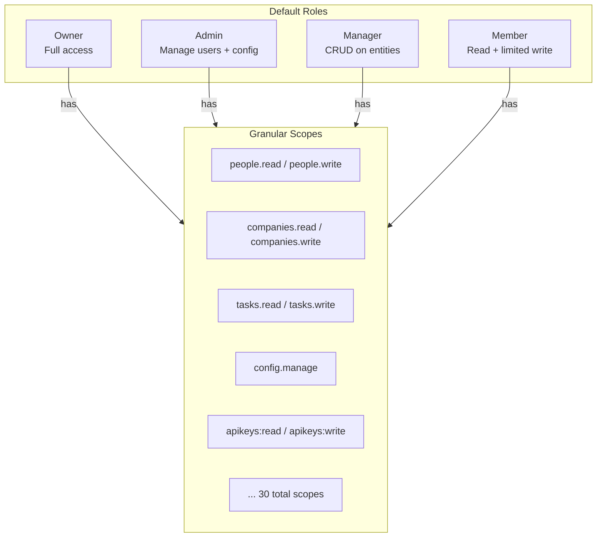
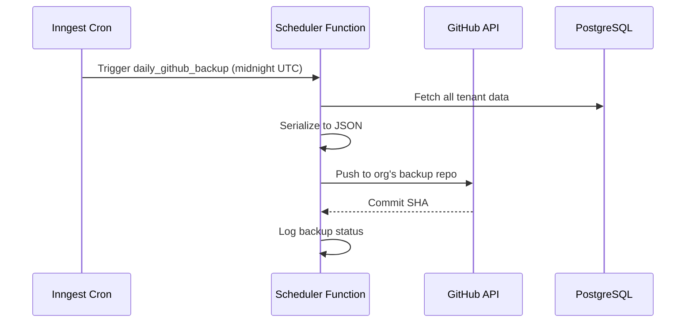
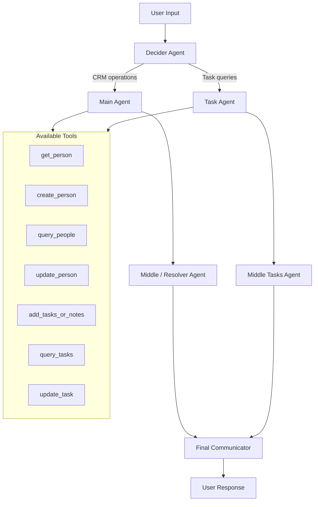

# FounderStack CRM — Backend

A multi-tenant CRM backend built with Django REST Framework, featuring RBAC, API key authentication, background job scheduling, AI agent integration, and external system sync (Notion).

## Tech Stack

| Layer | Technology |
|-------|-----------|
| Framework | Django 6.0, Django REST Framework 3.16 |
| Auth | JWT (RS256), API Keys, Session Auth, Google OAuth2 |
| Database | PostgreSQL 15 |
| Cache | Redis 7 |
| Background Jobs | Inngest |
| API Docs | drf-spectacular (OpenAPI/Swagger) |
| Containerization | Docker, Docker Compose |
| Server | Gunicorn, WhiteNoise (static) |

## Project Structure

```
backend/
├── core/                   # Django project config (settings, URLs, middleware)
├── app/                    # Core CRM domain models
├── api/                    # REST API layer (viewsets, serializers, filters)
├── users/                  # User management, auth, RBAC, organizations
├── integrations/           # API keys, webhooks, credentials, GitHub backup
├── dashboard/              # Dashboard configs, interaction types & logs
├── scheduler/              # Inngest background job scheduling
├── agent/                  # AI agent prompt templates (multi-agent CRM)
├── billing/                # Billing module (stub)
├── helpers/                # Utility code
├── notion_sync/            # Notion sync workflows & documentation
├── templates/              # Django email templates
├── static/                 # Static assets
├── tests/                  # Test scripts
├── docs/                   # Internal documentation
├── user_docs/              # End-user documentation
├── Dockerfile              # Python 3.12-slim + Gunicorn
├── docker-compose.yml      # web + PostgreSQL + Redis
├── reqs.txt                # Python dependencies
└── .env.example            # Environment variable template
```

## Architecture Overview

### High-Level System



### Django Apps



## Data Model

### Core Domain



### RBAC Model



## Authentication

The API supports three authentication methods:

### 1. JWT (RS256) — Primary for API/MCP

```
Authorization: Bearer <access_token>
```

- Access token lifetime: 7 days
- Refresh token lifetime: 90 days
- Keys: `jwt_private_key.pem` (sign), `jwt_public_key.pem` (verify)

### 2. API Keys — For External Integrations

```
Authorization: Api-Key <prefix><secret>
```

- 30 granular scopes (e.g. `people:read`, `companies:write`)
- Per-key rate limits and expiration
- SHA-256 hashed before storage

### 3. Session Auth — Browser SPA

Cookie-based via `dj-rest-auth` with custom tokens (`cccrm-access-token`, `cccrm-refresh-token`).

## API Endpoints

### Core CRM

| Endpoint | Methods | Description |
|----------|---------|-------------|
| `/api/companies/` | CRUD + bulk import + search | Company records |
| `/api/people/` | CRUD + bulk import + context | Person/lead records |
| `/api/people/{id}/context/` | GET | Full person profile with timeline |
| `/api/people/{id}/context/ai/` | GET | Person context for AI processing |
| `/api/opportunities/` | CRUD + bulk import | Deal pipeline |
| `/api/tasks/` | CRUD + bulk import | Task management |
| `/api/notes/` | CRUD + bulk import | Notes |
| `/api/activities/` | CRUD + bulk import | Activity logs (emails, calls, meetings) |
| `/api/config/` | GET/PUT | CRM pipeline configuration |
| `/api/search/` | GET `?q=query` | Cross-model fuzzy search |

### Users & Auth

| Endpoint | Methods | Description |
|----------|---------|-------------|
| `/api/auth/login/` | POST | Login (returns JWT) |
| `/api/auth/registration/` | POST | Register new user |
| `/api/auth/google/` | POST | Google OAuth2 login |
| `/api/auth/password/change/` | POST | Change password |
| `/api/org-users/` | GET | List org users |
| `/api/roles/` | CRUD | RBAC role management |
| `/api/invitations/` | CRUD | Team invitations |
| `/api/onboarding/` | CRUD | Onboarding wizard |

### Integrations

| Endpoint | Methods | Description |
|----------|---------|-------------|
| `/api/integrations/api-keys/` | CRUD + revoke | API key management |
| `/api/integrations/webhooks/` | CRUD + ping | Webhook subscriptions |
| `/api/integrations/credentials/` | CRUD | Credential storage |
| `/api/integrations/tenant-backup-config/` | CRUD | GitHub backup config |
| `/api/integrations/zernio/profiles/` | CRUD + ensure/sync | One Zernio profile per organization |
| `/api/integrations/zernio/accounts/` | List/detail/delete + sync/health | Connected social/messaging accounts |
| `/api/integrations/zernio/conversations/` | List/detail + sync/messages/read | Inbox and DM threads |
| `/api/integrations/zernio/posts/` | List/detail + publish/sync | Publishing and post analytics |
| `/api/integrations/zernio/analytics/` | Dashboard/daily/followers/delta | Per-customer analytics |
| `/api/integrations/zernio/oauth-apps/` | CRUD + test | White-label platform apps |
| `/api/integrations/zernio/webhook/` | POST | Signed Zernio webhook receiver |

### Zernio integration

Each organization gets one Zernio profile whose `externalId` is the organization
UUID, so every webhook can be routed back without a lookup. The first call to
`POST /api/integrations/zernio/profiles/ensure/` provisions the profile.

Webhook endpoint: `POST /api/integrations/zernio/webhook/`

```bash
# Register this URL in Zernio and copy the signing secret into .env
curl -X POST "https://your-domain/api/integrations/zernio/webhook/" \
  -H "X-Zernio-Signature: <hex-hmac-sha256-of-raw-body>"
```

Set `ZERNIO_API_KEY`, `ZERNIO_API_BASE_URL`, and `ZERNIO_WEBHOOK_SECRET` in
`.env`. Events are deduplicated on the Zernio event id and written to the local
inbox mirror. An Inngest cron (`zernio_sync_all`, hourly) refreshes accounts,
conversations, and analytics.

### Dashboard

| Endpoint | Methods | Description |
|----------|---------|-------------|
| `/api/interaction-types/` | CRUD | Interaction categories |
| `/api/interactions/` | CRUD | Interaction logs |
| `/api/dashboard-configs/` | CRUD | Per-user chart configs |
| `/api/views/` | CRUD | Custom saved views |
| `/api/reports/` | CRUD + share | Reports |

### Other

| Endpoint | Methods | Description |
|----------|---------|-------------|
| `/api/sync-records/` | CRUD | External sync state tracking |
| `/api/sync-logs/` | CRUD | Sync audit trail |
| `/api/schema/` | GET | OpenAPI schema |
| `/api/schema/swagger-ui/` | GET | Swagger UI |
| `/api/schema/redoc/` | GET | ReDoc |
| `/is_healthy/` | GET | Health check |

## Getting Started

### Prerequisites

- Python 3.12+
- PostgreSQL 15+
- Redis 7+
- Docker & Docker Compose (optional)

### Local Development
```bash
cd localdb && chmod +x startdb.sh
./startdb.sh
```

```bash
# 1. Clone the repo
git clone https://github.com/your-org/founderstack-crm-backend.git
cd founderstack-crm-backend

# 2. Create virtual environment
python -m venv .venv
source .venv/bin/activate

# 3. Install dependencies
pip install -r reqs.txt

# 5. Copy environment file
cp .env.example .env
# Edit .env with your values (see Environment Variables below)

# 6. Generate JWT keys
python generate_jwt_keys.py

# 7. Run migrations
python manage.py migrate sites
python manage.py makemigrations users
python manage.py migrate

python manage.py makemigrations app dashboard integrations
python manage.py migrate
# 7. Create superuser
python manage.py createsuperuser

# 8. Run the server
python manage.py runserver
```

### Docker

```bash
# Build and start all services
docker-compose up --build -d

# Run management commands
docker-compose exec web python manage.py createsuperuser

# View logs
docker-compose logs -f web
```

The app will be available at `http://localhost:8010`.

## Environment Variables

Copy `.env.example` to `.env` and configure with your own values:

```bash
cp .env.example .env
```

```bash
# Django
SECRET_KEY=<generate-a-strong-secret-key>
DEBUG=True
ALLOWED_HOSTS=localhost,127.0.0.1

# PostgreSQL
POSTGRES_DB=founderstack_db
POSTGRES_USER=founderstack_user
POSTGRES_PASSWORD=<your-password>
DB_HOST=db
DB_PORT=5432

# Redis
REDIS_URL_CACHE=redis://redis:6379/1

# JWT (RS256)
JWT_AUDIENCE=cccrm-api
JWT_ISSUER=cccrm-backend

# Google OAuth2
# (configure via django-allauth admin)

# FastAPI (optional — email service)
FASTAPI_URL=http://localhost:8080

# Inngest (background jobs)
INNGEST_SIGNING_KEY=<your-signing-key>
INNGEST_EVENT_KEY=<your-event-key>

# Notion (optional)
# UNIPILE_API_KEY=<your-unipile-key>

# Zernio (social/messaging integration)
ZERNIO_API_KEY=<your-zernio-api-key>
ZERNIO_API_BASE_URL=https://zernio.com/api/v1
ZERNIO_WEBHOOK_SECRET=<signing-secret-from-the-zernio-endpoint>

# Email
EMAIL_BACKEND=django.core.mail.backends.smtp.EmailBackend
EMAIL_HOST=smtp.zoho.com
EMAIL_PORT=587
EMAIL_HOST_USER=<your-email>
EMAIL_HOST_PASSWORD=<your-password>
```

## Background Jobs

Inngest handles scheduled and event-driven background tasks:



Currently active functions:
- **`daily_github_backup`** — Runs daily at midnight UTC, backs up all organization data to GitHub repos via the GitHub API.

## AI Agent System

The backend includes prompt templates for a multi-agent CRM assistant:



| Agent | File | Role |
|-------|------|------|
| Decider | `agent/decider.md` | Routes to Task Agent or Main Agent |
| Main | `agent/main_flow.md` | Plans CRM actions (CRUD on entities) |
| Task | `agent/tasks_agent.md` | Specialized task management |
| Voice | `agent/voice.md` | Combined planner for voice input |
| Middle | `agent/middle.md` | Resolves entity IDs from fuzzy queries |
| Middle Tasks | `agent/middle_tasks_agent.md` | Resolves task IDs |
| Final | `agent/final.md` | Formats user-facing responses |

## Testing

```bash
# Run all tests
pytest

# Run with verbose output
pytest -v

# Run specific app tests
pytest api/tests.py
pytest users/tests.py
pytest integrations/tests.py
```

## Linting

```bash
# Check code style
ruff check .

# Auto-fix
ruff check --fix .
```

## Key Features

- **Multi-Tenant Architecture** — Organization-based data isolation on all models
- **RBAC** — 4 default roles (Owner, Admin, Manager, Member) with 30 granular permission scopes
- **Triple Auth** — JWT (RS256) + API Keys + Session Auth, plus Google OAuth2
- **Fuzzy Search** — Custom relevance scoring (exact=100, starts_with=80, contains=60, etc.)
- **Bulk Import** — All major endpoints support array imports with auto-relation resolution
- **External Sync** — SyncRecord/SyncLog models for tracking Notion or other system sync state
- **GitHub Backup** — Automated daily backups to GitHub via Inngest cron jobs
- **Webhook System** — HMAC-SHA256 signed payloads with delivery logging
- **Custom Pipeline** — Configurable stages for leads, opportunities, and lead types
- **OpenAPI Docs** — Full schema at `/api/schema/swagger-ui/`

## License

GNU GENERAL PUBLIC LICENSE

---

> **Security Note:** The `.env.example` file contains only placeholder values. Never commit your actual `.env` file to version control. Rotate all secrets before deploying to production.
