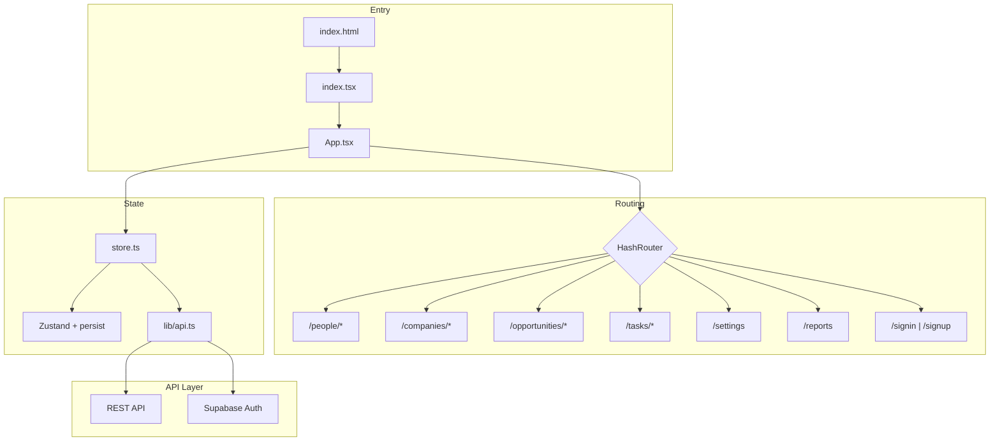
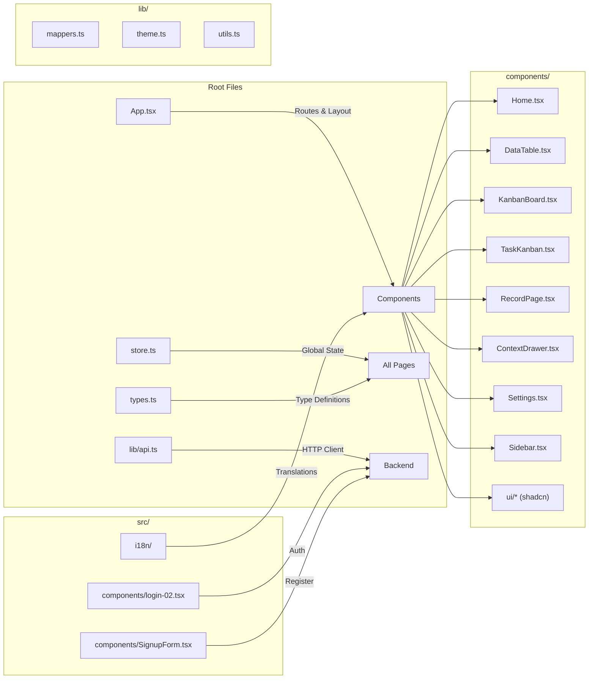
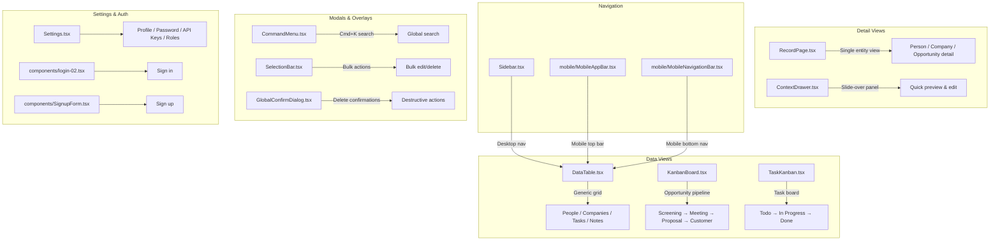

<div align="center">

# FounderStack CRM Frontend

A context-first CRM for solo founders featuring a Notion-style dark mode interface, data grids, kanban boards, and AI-assisted relationship management.


</div>

---

## Architecture



## Project Structure



## Key Files

| File | Purpose |
|------|---------|
| `App.tsx` | Root component. Defines all routes, handles auth guards, keyboard shortcuts, and layout shell. |
| `store.ts` | Zustand global store. Manages all entity state (people, companies, tasks, opportunities, notes, activities), auth tokens, UI state (sidebar, drawers, selections), and API fetching. |
| `types.ts` | TypeScript interfaces for all domain entities: `Person`, `Company`, `Opportunity`, `Task`, `Note`, `ActivityLog`, `Report`, `User`, etc. |
| `lib/api.ts` | HTTP client layer. Wraps `fetch` with JWT auth, token refresh logic, and all REST endpoint functions. |
| `lib/mappers.ts` | Bidirectional mapping between backend (snake_case) and frontend (camelCase) data formats. |
| `lib/supabase.ts` | Supabase client initialization for email/password authentication. |
| `src/i18n/` | Internationalization system with English and Arabic (RTL) support. |
| `constants.ts` | App-wide constants (currently minimal). |

## Component Overview



## Tech Stack

| Layer | Technology |
|-------|-----------|
| Framework | React 19 + TypeScript |
| Styling | Tailwind CSS v4 |
| State | Zustand 5 with `persist` middleware |
| Routing | React Router DOM 7 (HashRouter) |
| Drag & Drop | @dnd-kit (core + sortable + modifiers) |
| Charts | Recharts 3 |
| UI Primitives | Radix UI (dialog, dropdown, popover, alert-dialog, avatar, label, separator, tooltip) |
| UI Components | Custom shadcn/ui-style components (`components/ui/`) |
| Auth | Supabase (email/password) |
| Analytics | PostHog (optional, env-configurable) |
| Notifications | Sonner (toast) |
| Date | date-fns |
| Icons | Tabler Icons + Lucide |

## Getting Started

### Prerequisites

- Node.js 18+
- A running backend API (see [backend/README.md](https://github.com/Othunderlight/FounderStackCRM/blob/main/backend/README.md))

### Setup

```bash
# Clone the repo
git clone https://github.com/Othunderlight/FounderStackCRM.git
cd FounderStackCRM/frontend

# Install dependencies
npm install

# Create your env file
cp .env.example .env.local
```

### Environment Variables

Configure your `.env.local` file (see `.env.example` for all options):

```env
# Backend API
VITE_API_BASE_URL=http://localhost:8010
VITE_FAST_AI_BASE_URL=http://localhost:8080

# Supabase (auth)
VITE_SUPABASE_URL=https://your-project.supabase.co
VITE_SUPABASE_ANON_KEY=your-anon-key

# PostHog (optional analytics)
VITE_POSTHOG_ENABLED=false
VITE_POSTHOG_KEY=your-posthog-key
VITE_POSTHOG_HOST=https://eu.i.posthog.com
```

### Run

```bash
npm run dev
```

The app runs at `http://localhost:3000`.

### Build

```bash
npm run build
```

Output goes to `dist/`.

## Features

- **Data Grids** -- Sortable, filterable, column-customizable tables for People, Companies, Tasks, Notes, and Activities
- **Kanban Boards** -- Drag-and-drop pipeline view for Opportunities and Tasks
- **Context Drawer** -- Slide-over panel for quick record preview and editing
- **Command Menu** -- Cmd+K global search across all entities
- **Custom Views** -- Save and switch between custom filter/sort/column configurations per entity
- **Reports** -- Build, save, and share filtered data snapshots
- **RBAC** -- Role-based access control with granular permissions and hidden fields
- **Internationalization** -- English and Arabic with full RTL support
- **Mobile Responsive** -- Dedicated mobile navigation, app bar, and bottom nav
- **Dark Mode** -- Notion-style dark theme by default
- **Bulk Actions** -- Multi-select records for batch operations
- **CSV Import** -- Import data from CSV files for any entity type
- **Keyboard Shortcuts** -- `Shift+P` people, `Shift+T` tasks, `Shift+C` companies, `Shift+L` logs

## Keyboard Shortcuts

| Shortcut | Action |
|----------|--------|
| `Ctrl/Cmd + B` | Toggle sidebar |
| `Shift + P` | Go to All People |
| `Shift + T` | Go to All Tasks |
| `Shift + C` | Go to Companies |
| `Shift + L` | Go to Activity Logs |

## License

MIT

---

> **Security Note:** The `.env.example` file contains only placeholder values. Never commit your actual `.env.local` file to version control. The backend `.env.example` at the project root also contains only placeholders.
